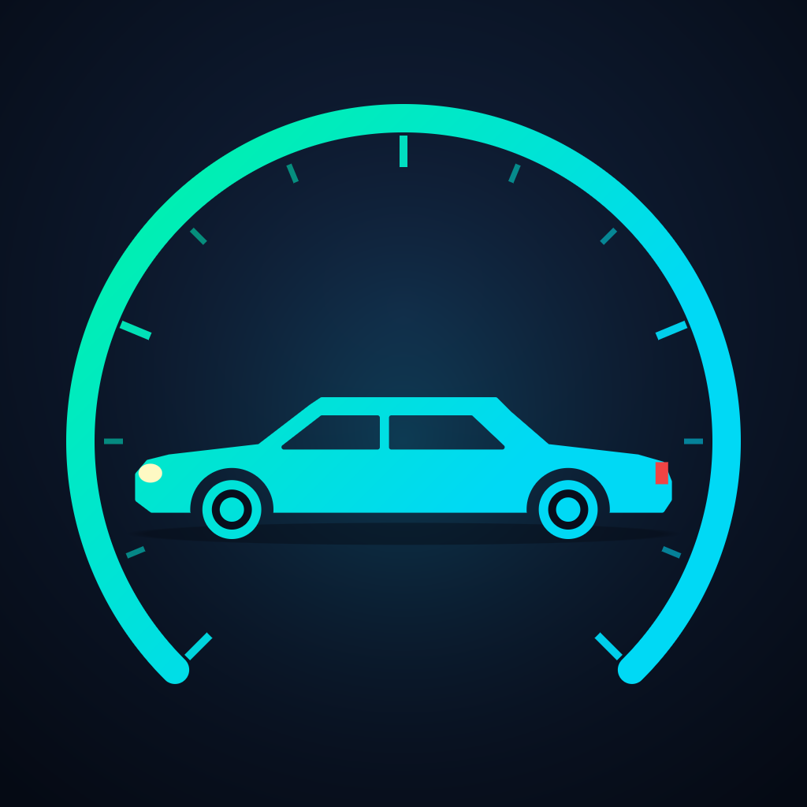
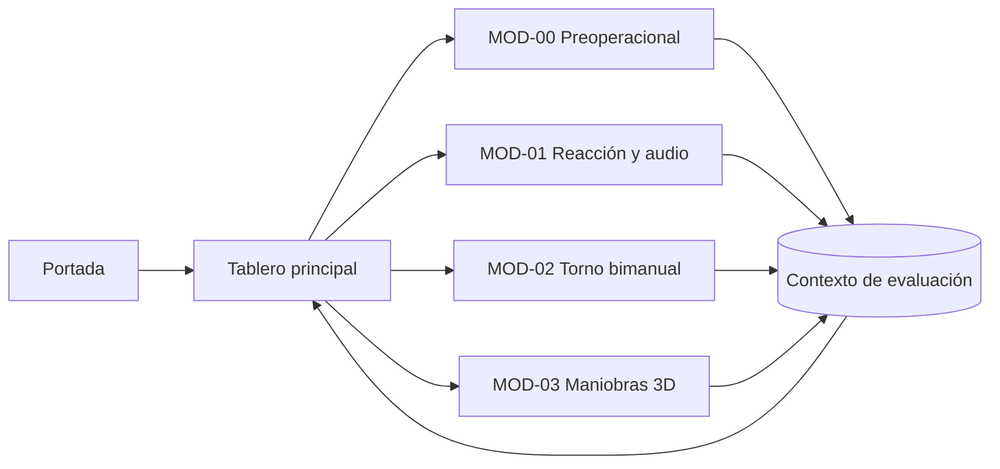
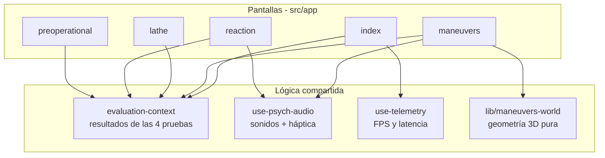

<div align="center">



# AutoTest Conducción
### Simulador psicotécnico y de maniobras 3D para aspirantes a licencia de conducción

Aplicación móvil multiplataforma (Android · iOS · Web) hecha con **React Native + Expo SDK 58**

`React Native 0.88` · `Expo Router` · `TypeScript` · `react-native-svg` · `expo-audio` · `expo-speech`

</div>

---

## Tabla de contenido

1. [Resumen del proyecto](#1-resumen-del-proyecto)
2. [Problema y objetivos](#2-problema-y-objetivos)
3. [Módulos de la aplicación](#3-módulos-de-la-aplicación)
4. [Simulador 3D en detalle](#4-simulador-3d-en-detalle)
5. [Arquitectura](#5-arquitectura)
6. [Tecnologías y para qué se usa cada una](#6-tecnologías-y-para-qué-se-usa-cada-una)
7. [Estructura del repositorio](#7-estructura-del-repositorio)
8. [Instalación y ejecución](#8-instalación-y-ejecución)
9. [Llevarlo al celular (APK / binario)](#9-llevarlo-al-celular-apk--binario)
10. [Identidad visual y logo](#10-identidad-visual-y-logo)
11. [Rendimiento y pruebas](#11-rendimiento-y-pruebas)
12. [Sistema de calificación](#12-sistema-de-calificación)
13. [Limitaciones y trabajo futuro](#13-limitaciones-y-trabajo-futuro)
14. [Guion sugerido para la presentación](#14-guion-sugerido-para-la-presentación)

---

## 1. Resumen del proyecto

**AutoTest Conducción** es una aplicación móvil que reúne en un solo lugar las pruebas que normalmente se hacen por separado antes de obtener o renovar una licencia: revisión preoperacional del vehículo, reacción auditivo-motora, coordinación de las dos manos y práctica de maniobras de parqueo.

El usuario recorre cuatro módulos, cada uno guarda su resultado y un tablero principal resume la sesión con la nota de cada prueba (`EXCELENTE`, `APTO`, `NO APTO`).

Todo se ejecuta **sin conexión a internet** y sin servidores: la lógica, la física y el dibujo 3D corren en el propio dispositivo.

## 2. Problema y objetivos

**Problema.** Las pruebas de aptitud y de práctica suelen presentarse de forma teórica y sin retroalimentación inmediata. El aspirante no practica el reconocimiento de fallas del vehículo, ni la coordinación bajo presión, ni el manejo real de pedales, caja de cambios y volante antes del examen.

**Objetivo general.** Desarrollar una aplicación móvil que permita practicar y evaluar las competencias básicas de conducción de forma interactiva.

**Objetivos específicos**

- Enseñar a identificar fallas comunes del vehículo y cómo corregirlas (módulo preoperacional con voz explicativa).
- Medir la reacción auditivo-motora por oído (módulo con audífonos).
- Evaluar la coordinación de ambas manos con dificultad que se adapta al usuario.
- Simular la cabina completa de un carro manual y tres maniobras de parqueo en un entorno 3D.
- Mantener una experiencia fluida en un celular de gama media.

## 3. Módulos de la aplicación

| Módulo | Archivo | Qué hace |
| :--- | :--- | :--- |
| **Portada y tablero** | `src/app/index.tsx` | Imagen de bienvenida, telemetría en vivo (FPS y latencia de audio), tarjetas de acceso a cada prueba y tabla de baremos oficiales. |
| **MOD-00 · Preoperacional** | `src/app/preoperational.tsx` | Laboratorio visual de 6 sistemas del carro: motor y fluidos, llantas (PSI), luces, espejos, cabina y kit de carretera. Arriba hay una **silueta de carro** con 6 puntos; el punto activo repite en bucle *problema → qué hacer → resultado* y marca la zona exacta del carro. Una **voz en español** narra cada lección al iniciarla. |
| **MOD-01 · Reacción y audio** | `src/app/reaction.tsx` | Pantalla dividida (roja = mano izquierda, verde = derecha). Tonos de 440 Hz y 880 Hz por oído, tiempo de reacción en ms, salidas en falso y modos *audio + visual*, *solo audio*, *solo visual*. Requiere audífonos. |
| **MOD-02 · Torno bimanual** | `src/app/lathe.tsx` | Dos carriles ondulados y dos cursores que se arrastran a la vez, uno por mano. Mide la precisión de cada carril y el tiempo fuera de pista. La **velocidad es adaptativa**: sube si el usuario lo hace bien y baja si se sale. |
| **MOD-03 · Maniobras 3D** | `src/app/maneuvers.tsx` | Simulador en primera persona con 3 niveles: parqueo en bahía a 90°, parqueo en paralelo y eslalon de conos. Cuenta tiempo, conos tocados y alineación con la zona `[P]`. |

### Flujo de la aplicación



## 4. Simulador 3D en detalle

El mundo 3D **no usa un motor externo**: se proyecta en perspectiva con matemática propia y se dibuja como SVG. Eso da control total, funciona igual en Android, iOS y Web y evita dependencias nativas pesadas.

**Cabina en primera persona**
- Volante que se arrastra con el dedo.
- Caja de cambios manual en H (`R`, `N`, `1` a `5`), también con botones.
- Tres pedales independientes: **embrague, freno y acelerador** (con botón para fijar el acelerador).
- Freno de mano, direccionales, intermitentes, luces, limpiaparabrisas y cinturón.
- Tacómetro, velocímetro e indicador de marcha.

**Física del vehículo**
- Modelo cinemático (ángulo de dirección y distancia entre ejes).
- Aceleración gradual por marcha con suavizado exponencial del pedal para evitar tirones.
- Freno de motor al soltar, ralentí y revoluciones que dependen de la velocidad.

**Cámara y entorno vivos**
- Cabeceo al acelerar y frenar, balanceo en curvas, retraso de la vista al girar y vibración leve del pavimento.
- Cielo con sol y halo, nubes con deriva, montañas con paralaje, bruma de distancia y viñeta que aumenta con la velocidad.
- Edificios, pórtico vial, autos estacionados, árboles que se mecen, farolas con brillo, conos, flechas, paso cebra y huellas de neumáticos.
- Los faros proyectan haces de luz sobre el asfalto.

**Controles**
- Celular: todo táctil; la pantalla gira sola a horizontal.
- Web: `W/↑` acelerador, `S/↓` freno, `C/Shift` embrague, `A/D` o flechas para el volante, `1`–`5`, `R`, `N` para las marchas.

## 5. Arquitectura



Decisiones de diseño importantes:

- **Estado global mínimo**: un único contexto guarda los resultados de las pruebas; cada pantalla maneja su propio estado.
- **Física fuera de React**: la simulación vive en un `useRef` y se actualiza en un bucle de `requestAnimationFrame`; React solo recibe una "foto" para dibujar. Así la física no depende de cuántas veces se renderiza.
- **Geometría 3D como módulo puro** (`src/lib/maneuvers-world.ts`, sin React): permite medir su rendimiento por separado con `npm run bench`.
- **React Compiler** activado, que memoriza automáticamente los componentes y evita renders innecesarios.

## 6. Tecnologías y para qué se usa cada una

| Tecnología | Para qué se usa |
| :--- | :--- |
| **React Native 0.88 + React 19** | Base de la interfaz móvil. |
| **Expo SDK 58** | Herramientas de compilación, módulos nativos y servicio de builds (EAS). |
| **Expo Router** | Navegación por archivos en `src/app/` (`index`, `preoperational`, `reaction`, `lathe`, `maneuvers`). |
| **react-native-svg** | Todo el dibujo: escena 3D proyectada, carriles del torno, silueta del carro e ilustraciones técnicas. |
| **react-native-gesture-handler** | Gestos multitáctiles: volante, caja de cambios y los dos cursores del torno a la vez. |
| **react-native-reanimated / worklets** | Animaciones fluidas del sistema. |
| **expo-audio** | Tonos de 440 Hz / 880 Hz y sonidos de éxito y error (`assets/sounds/*.wav`). |
| **expo-haptics** | Vibración al responder o equivocarse. |
| **expo-speech** | Voz en español que narra cada lección del preoperacional. |
| **expo-image** | Imagen de portada con transición. |
| **@expo/vector-icons / expo-symbols** | Iconos. |
| **TypeScript (modo estricto)** | Tipado estático para evitar errores. |
| **EAS Build** | Generar el APK instalable. |
| **pngjs** *(solo desarrollo)* | Generar el logo por código (`npm run icons`). |

## 7. Estructura del repositorio

```
├── app.json                    # Nombre, íconos, splash, paquete Android/iOS
├── eas.json                    # Perfiles de build (APK)
├── assets/
│   ├── images/                 # Logo, splash, íconos adaptativos, portada
│   └── sounds/                 # Tonos .wav (440 Hz, 880 Hz, éxito, error)
├── scripts/
│   ├── bench-world3d.ts        # Prueba de rendimiento del motor 3D
│   └── generate-icons.mjs      # Generador del logo (SDF, sin dependencias gráficas)
└── src/
    ├── app/
    │   ├── _layout.tsx         # Navegación, tema oscuro y proveedor de evaluación
    │   ├── index.tsx           # Portada + tablero
    │   ├── preoperational.tsx  # Inspección con silueta animada y voz
    │   ├── reaction.tsx        # Reacción y audio
    │   ├── lathe.tsx           # Torno bimanual adaptativo
    │   └── maneuvers.tsx       # Cabina y simulación 3D
    ├── components/
    │   └── telemetry-header.tsx  # Encabezado con FPS, latencia y prueba de audio
    ├── context/
    │   └── evaluation-context.tsx  # Resultados de las 4 pruebas
    ├── hooks/
    │   ├── use-psych-audio.ts  # Sonidos izquierda/derecha/éxito/error + háptica
    │   └── use-telemetry.ts    # Medición de FPS y estado del sistema
    ├── lib/
    │   └── maneuvers-world.ts  # Geometría 3D, escenarios y proyección (módulo puro)
    └── constants/
        └── theme.ts            # Paleta, tipografías y baremos oficiales
```

## 8. Instalación y ejecución

Requisitos: **Node.js 20 o superior** y un celular con **Expo Go** (opcional).

```bash
npm install                # instalar dependencias
npx expo start             # servidor de desarrollo: escanear el QR con Expo Go, o pulsar "w" para Web
npx expo start -c          # lo mismo limpiando la caché de Metro

npm run typecheck          # verificar tipos (tsc --noEmit)
npm run lint               # linter oficial de Expo
npm run bench              # prueba de rendimiento del motor 3D
npm run icons              # regenerar el logo y los íconos
```

> **Importante:** Expo Go corre en *modo desarrollo*, que es bastante más lento que la app final. Para evaluar la fluidez real o presentar, usa el APK de la sección siguiente.

## 9. Llevarlo al celular (APK / binario)

### Opción A · APK en la nube con EAS (recomendada, no necesita Android Studio)

```bash
npm install -g eas-cli
eas login                              # cuenta gratuita de Expo
eas build -p android --profile preview # genera un APK instalable
```

Al terminar, EAS entrega un enlace y un QR: se abre en el celular, se descarga el `.apk` y se instala (hay que permitir "instalar apps de orígenes desconocidos").

### Opción B · Compilar local (necesita Android Studio y el SDK)

```bash
npx expo run:android --variant release
```

Instala en el celular conectado por USB (con la depuración USB activada) una versión **release**, sin las herramientas de desarrollo.

### Qué verá el usuario al instalar

- **Ícono** del carro dentro del velocímetro en el escritorio del celular (con versión adaptativa y monocromática en Android).
- **Pantalla de carga** con el logo sobre fondo azul marino `#050A14`, y luego la portada.
- Nombre de la app: **AutoTest Conducción** · paquete `com.sergidm.autotestconduccion`.

## 10. Identidad visual y logo

El logo es la **silueta de un carro dentro de un velocímetro**: el arco representa la medición (psicotecnia) y el carro la conducción. Usa el degradado verde menta → cian de la interfaz sobre azul marino profundo.

| Elemento | Color |
| :--- | :--- |
| Fondo principal | `#050A14` |
| Paneles | `#0A1222` / `#0F1A2E` |
| Acento positivo / correcto | Verde menta `#00F5A0` |
| Acento informativo | Cian `#00D9F5` |
| Alerta | Ámbar `#F59E0B` · Error rojo `#EF4444` |

El logo se genera **por código** (`scripts/generate-icons.mjs`) con campos de distancia y antialias analítico, así que puede regenerarse en cualquier tamaño sin editor gráfico. Produce el ícono principal, el primer plano / fondo / monocromo de Android adaptativo, la imagen de carga y el favicon web.

## 11. Rendimiento y pruebas

El objetivo fue lograr **máxima fluidez sin quitar ninguna interfaz ni animación**.

### Prueba automática del motor 3D

`npm run bench` simula una conducción de 12 s (720 cuadros a 60 FPS) en cada uno de los 3 niveles y mide cuánto tarda en calcularse cada cuadro del mundo 3D.

| Nivel | Media | p95 | Máximo | Polígonos por cuadro |
| :--- | :---: | :---: | :---: | :---: |
| 1. Parqueo [P] 90° | 0.31 ms | 0.52 ms | 1.08 ms | 61 |
| 2. Paralelo [P] | 0.27 ms | 0.45 ms | 0.72 ms | 41 |
| 3. Eslalon de conos | 0.26 ms | 0.37 ms | 0.53 ms | 49 |

**Media global ≈ 0.28 ms por cuadro, es decir el 1.7 % del presupuesto de 16.6 ms** que se tiene a 60 FPS (medido en PC; en un celular de gama media el cálculo puede ser varias veces más lento y aun así queda muy por debajo del presupuesto).

### Optimizaciones aplicadas

| Optimización | Efecto |
| :--- | :--- |
| Geometría 3D extraída a un módulo puro y medible | Se puede probar y optimizar sin abrir la app. |
| Recorte por distancia (`DRAW_DISTANCE = 900`, `TILE_DISTANCE = 780`) | Lo que queda lejos y oculto por la bruma ya no genera nodos SVG. |
| Redibujado adaptativo | En movimiento se actualiza a cada cuadro; **detenido, a 20 FPS**. Las animaciones de reposo (vibración del motor, viento, nubes) se siguen viendo igual de fluidas y se ahorra mucha CPU/batería. |
| Física en `useRef` + `requestAnimationFrame` | La simulación no depende de los renders de React. |
| Suavizado exponencial independiente del tiempo (`dt`) | El movimiento se ve igual a 30, 60 o 120 Hz. |
| React Compiler | Memoriza componentes y evita re-renders de la cabina cuando no cambian. |
| Aislamiento de componentes con estado propio (p. ej. la silueta animada) | El temporizador de la animación no vuelve a dibujar toda la pantalla. |
| Buffer de huellas limitado (30) y HUD actualizado cada ~95 ms | Menos estado cambiando por segundo. |

### Verificaciones de calidad

```bash
npm run typecheck   # 0 errores de tipos
npm run lint        # 0 errores del linter de Expo
npm run bench       # rendimiento del motor 3D
```

### Cómo medir la fluidez en el celular

1. Instalar el **APK de release** (Opción A o B), no Expo Go.
2. En el tablero principal, el panel **Diagnóstico de hardware y telemetría** muestra **FPS** y **tiempo de cuadro** en vivo.
3. Entrar a *Maniobras 3D*, acelerar en 5ª marcha y girar: el comportamiento esperado es estable cerca de 60 FPS en gama media.

## 12. Sistema de calificación

Cada prueba entrega una nota que se guarda en el tablero. Los baremos que muestra la app son:

| Módulo | Excelente | Apto | No apto |
| :--- | :--- | :--- | :--- |
| **Preoperacional** | 100 % de puntos + anomalías corregidas | ≥ 85 % de puntos | < 85 % o falla crítica |
| **Reacción auditiva** | < 260 ms | 260 – 380 ms | > 380 ms o más de 2 fallos |
| **Torno bimanual** | ≥ 90 % de precisión | 75 – 89 % | < 75 % |
| **Maniobras 3D** | < 55 s y 0 conos con cinturón puesto | resto de casos aprobados | > 3 conos o > 120 s |

> Los baremos son una referencia educativa basada en protocolos de prueba (PESV, pruebas psicotécnicas y prácticas de conducción); no sustituyen un examen oficial.

## 13. Limitaciones y trabajo futuro

**Limitaciones actuales**
- El mundo 3D está dibujado con SVG proyectado, no con GPU 3D; es muy fluido en este escenario, pero no escalaría a ciudades enormes.
- La voz depende de las voces instaladas en el celular. Para una voz más natural conviene descargar una voz mejorada en español en los ajustes del sistema.
- Los resultados se guardan solo durante la sesión (sin base de datos).

**Trabajo futuro**
- Guardar historial de resultados y mostrar la evolución del aspirante.
- Voz neuronal en la nube (por ejemplo Gemini TTS) para la narración.
- Más niveles (rotonda, pendiente, reversa en curva) y tráfico simulado.
- Motor 3D con GPU (Skia / `react-native-skia`) para escenas más complejas.
- Exportar un reporte en PDF para el instructor.

## 14. Guion sugerido para la presentación

1. **Problema** (1 min): las pruebas son teóricas y sin práctica previa.
2. **Demostración rápida** (5 min), en este orden:
   1. Portada y tablero con la telemetría en vivo.
   2. *Preoperacional*: mostrar la silueta con el bucle problema → acción → resultado y la voz.
   3. *Reacción*: con audífonos, tono por oído.
   4. *Torno*: dos manos y velocidad adaptativa.
   5. *Maniobras 3D*: cabina, pedales, caja de cambios y parqueo.
3. **Cómo está hecho** (2 min): Expo + React Native, SVG proyectado, física en `requestAnimationFrame`.
4. **Rendimiento** (1 min): resultado de `npm run bench` y los FPS en el celular.
5. **Conclusiones y trabajo futuro** (1 min).

---

<div align="center">

Proyecto final · Aplicaciones móviles
Repositorio: <https://github.com/sergiDM-0/Proyecto-final-App-Moviles>

</div>
